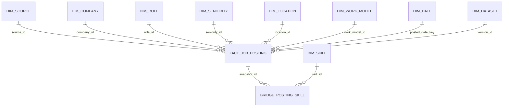

# Star Schema phục vụ phân tích

## Kiến trúc

`Dữ liệu → lõi 3NF → ETL data mart Star → v_star_postings → notebook / dashboard`

Lõi 3NF quản lý dữ liệu và kiểm tra chất lượng. Star là **các bảng vật lý** riêng, không chỉ đổi tên view. Hai lớp ở chung file SQLite `data/jobs.db`.

## Grain

Một dòng `fact_job_posting` = một tin đăng theo nguồn trong một phiên bản dữ liệu.
Khóa chính: `snapshot_id`. Khóa ứng viên: `(version_id, posting_id)`.
Luôn lọc phiên bản đang hoạt động trước khi cộng số tin. Cộng qua nhiều phiên bản sẽ đếm lại cùng tin.



## Bảng

| Bảng | Vai trò |
|---|---|
| fact_job_posting | Khóa dimension, định danh tin, các số đo và thuộc tính mô tả tin |
| dim_source | Nguồn tin |
| dim_company | Tên công ty chuẩn hóa |
| dim_role | Nhóm nghề |
| dim_seniority | Cấp bậc |
| dim_location | Địa điểm phân loại |
| dim_work_model | Mô hình làm việc |
| dim_date | Ngày, tháng, quý, năm, tuần ISO, thứ; không tách thêm bảng năm/tháng |
| dim_dataset | Phiên bản và thông tin lần nhập |
| dim_skill | Danh mục kỹ năng |
| bridge_posting_skill | Quan hệ nhiều–nhiều tin/kỹ năng; khóa (snapshot_id, skill_id) |

Đây là Star mở rộng với bảng cầu cho dimension đa trị. Các dimension mô tả trực tiếp fact, không chuẩn hóa thành chuỗi dimension con như Snowflake. Các ID danh mục được giữ ổn định từ lõi; quan hệ FK của lớp Star chỉ trỏ trong Star.

## Measures và thuộc tính

- `posting_count = 1`: cộng được trong cùng phiên bản và phạm vi lọc.
- `skill_count`: số kỹ năng phân biệt của tin; tổng là số quan hệ tin–kỹ năng, không phải tổng kỹ năng duy nhất.
- `salary_numeric`: 0/1, số tin có lương số; có thể tính tỷ lệ bằng SUM / SUM(posting_count).
- `salary_comparable`: 0/1, đủ hai cận VND và ghi rõ kỳ tháng; tiếp tục tách gross/net/unknown.
- `salary_min`, `salary_max`, `salary_midpoint`, `salary_range_width`: không cộng giữa các tin/tiền tệ/kỳ lương; dùng phân phối hoặc trung vị sau khi lọc cùng cơ sở.
- `posting_id`, tiêu đề và URL là thông tin nhận diện trực tiếp; không tạo bảng dimension một dòng cho mỗi tiêu đề.
- Ngày chưa xác định dùng khóa 0 trong dim_date với các thuộc tính ngày NULL; không gán ngày nhập thay ngày đăng.

## Cập nhật

Pipeline cập nhật lõi và mart trong cùng transaction, sau đó chuyển active_dataset. Nếu tạo fact/bridge thất bại, cả phiên bản mới rollback. Các phiên bản cũ được giữ lại. Watcher tiếp tục dùng pipeline đó.

Để tạo lại toàn bộ mart sau khi sửa logic:

```powershell
.\.venv\Scripts\python.exe -m joblab.star
```

Không sửa trực tiếp fact/dimension bằng tay. Hiện không có SCD Type 2 riêng cho từng dimension: dữ liệu phân loại thay đổi theo snapshot; danh mục dùng ID ổn định. Nếu cần quản lý lịch sử tên doanh nghiệp độc lập với snapshot thì phải bổ sung SCD.

## Tránh đếm trùng

View v_star_postings có đúng một dòng/fact, không JOIN bảng cầu. Lọc kỹ năng dùng EXISTS hoặc tập snapshot_id, sau đó tính KPI trên fact. Khi phân tích từng kỹ năng, một tin có thể thuộc nhiều nhóm nên tổng tỷ lệ có thể vượt 100%.

```sql
SELECT r.name, SUM(f.posting_count) AS posting_count
FROM fact_job_posting f
JOIN dim_role r ON r.id=f.role_id
JOIN active_dataset a ON a.version_id=f.version_id AND a.slot=1
GROUP BY r.name;
```
