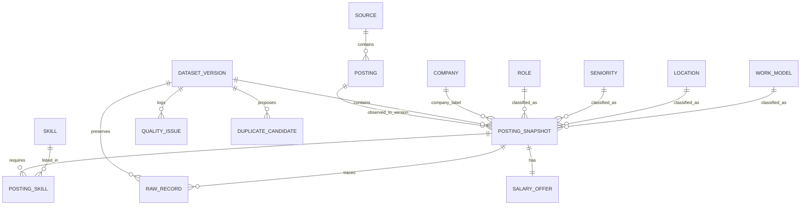

# Thiết kế kỹ thuật

## Nguồn gốc và phạm vi

- Repo: https://github.com/SonPhatTranDeveloper/vietnam-it-job-trends
- Commit kế thừa: `ad40de27b52f2f222c703e5b55f375d53f46d814`.
- File đầu vào: `data/step-07-jev-extracted.jsonl` của tác giả, sao chép nguyên byte sang `data/input/published_jobs.jsonl`.
- `reference-upstream.zip` giữ mã nguồn và dữ liệu công bố để tham khảo; chưa chạy các crawler hoặc các lời gọi AI.
- Bản raw của bài này là **file công bố đã xử lý**, không phải dữ liệu thô trước pipeline gốc.
- Đơn vị phân tích: một tin đăng trên một nguồn. Không gọi là số vị trí/nhân sự hoặc việc làm duy nhất.

## Luồng thực thi

JSONL công bố → kiểm tra cấu trúc → chuẩn hóa bảo thủ → tìm cặp nghi trùng → transaction nạp CSDL → kích hoạt phiên bản → view phân tích → notebook và dashboard.

ID phiên bản = SHA256(hash nội dung + phiên bản quy tắc). Cùng đầu vào và quy tắc không nạp lặp. File lỗi không thay phiên bản đang hoạt động. CSDL lưu lịch sử các lần nhập, không coi đó là lịch sử ngày cào. Bản input phải là một snapshot đầy đủ; thay bằng file chỉ chứa tin mới sẽ khiến dashboard chỉ hiện snapshot nhỏ đó.

## Mô hình quan hệ

### Khóa và phụ thuộc hàm của lõi phân tích

| Quan hệ | Khóa và phụ thuộc chính |
|---|---|
| source/company/role/seniority/location/work_model/skill | id → name, key; key là khóa ứng viên duy nhất |
| posting | id → source_id, url; id là hash xác định từ nguồn + URL đã chuẩn hóa |
| posting_snapshot | id → version_id, posting_id, company_id, các FK phân loại, title, description, posted_date, date_status; (version_id, posting_id) là khóa ứng viên |
| salary_offer | snapshot_id → status, min, max, currency, pay_period, gross_net |
| posting_skill | Khóa ghép (snapshot_id, skill_id); không có thuộc tính không khóa |

Các thuộc tính mô tả nguồn, công ty, kỹ năng và nhóm phân loại được tách khỏi snapshot; các danh sách kỹ năng được tách thành quan hệ nhiều–nhiều. Không lưu trung điểm lương hoặc tỷ lệ tổng hợp trong lõi; tính khi đọc. Với các phụ thuộc nghiệp vụ trên, các bảng lõi được tổ chức theo 3NF. Tên công ty chỉ chuẩn hóa khoảng trắng/Unicode/chữ hoa thường; chưa nhận diện pháp nhân hay gộp công ty có tên khác nhau.

`raw_record` là lớp lưu trữ đầu vào JSON và `quality_issue` là nhật ký kiểm tra, không sử dụng chúng như bảng phân tích đã chuẩn hóa. Một posting có một nhãn địa điểm/cấp bậc chính vì file nguồn đã giản lược như vậy; không giả định có dữ liệu nhiều địa điểm chi tiết.

### Lớp phân tích Star Schema

Lớp vật lý gồm `fact_job_posting`, 9 dimension và `bridge_posting_skill`. Grain: một tin đăng trong một phiên bản dữ liệu. `v_star_postings` nối fact với dimension, không nối bảng cầu; notebook/dashboard đọc view này. `v_postings` vẫn được giữ làm view đối chiếu của lõi 3NF.

Chi tiết ERD, measures, khóa, ETL và giới hạn cộng số liệu: xem `STAR_SCHEMA.md`.

## Quy tắc làm sạch

- Văn bản: Unicode NFC, gộp khoảng trắng; giữ JSON nguyên trạng.
- Kỹ năng: chỉ dùng tech_stack AI, chuẩn hóa bí danh trong `cleaning.py`; Java/JavaScript, C#/C++ không bị gộp.
- Ngày: chỉ đọc ngày ISO tường minh; không suy ngày từ “3 days ago” khi thiếu thời điểm cào đáng tin cậy.
- Lương: tách trạng thái missing/hidden/negotiable/unpaid/range/exact/lower_bound/upper_bound/unparsed/invalid. Thiếu kỳ thì unknown; không tự quy đổi tiền tệ hoặc kỳ trả lương. Không tự sửa khoảng đảo cận.
- Phân loại: giữ danh mục AI kế thừa; giá trị ngoài danh mục chuyển Unknown và ghi lỗi.
- Trùng URL trong cùng nguồn: giữ dòng đầu, lưu tất cả dòng gốc và ghi nhận dòng lặp.
- Liên nguồn: cùng tên công ty chuẩn hóa + tương đồng tiêu đề ≥ 0,85 tạo **ứng viên**. Không tự động gộp, chưa có precision/recall được kiểm chứng. CSV ứng viên chỉ để kiểm tra, chưa có thao tác nhập quyết định/gộp thực thể.

## Định nghĩa chỉ số

| Chỉ số | Định nghĩa |
|---|---|
| Số tin | Số posting phân biệt trong phiên bản và bộ lọc |
| Số công ty | Số tên công ty chuẩn hóa khác nhau, loại Unknown; không phải pháp nhân đã xác minh |
| skill_count | Số skill phân biệt gắn với snapshot |
| Tỷ lệ kỹ năng X | Số tin chứa X / toàn bộ tin trong nhóm lọc |
| Lương số | Tin có trạng thái range/exact/lower_bound/upper_bound |
| Trung điểm | (min + max)/2 nếu đủ cận; không phải lương thực nhận |
| Độ rộng khoảng | max − min nếu đủ cận |
| Mẫu so sánh lương | Đủ cận, VND, ghi rõ month; tiếp tục tách gross/net/unknown |
| Remote toàn mẫu | Số tin Remote / toàn bộ tin; giữ Unknown trong mẫu số |
| Tỷ lệ thiếu | Số tin không xác định chỉ tiêu / số tin trong nguồn và bộ lọc |

## Tự động hóa

`python -m joblab.pipeline --watch --interval 60` đọc lại file snapshot mỗi 60 giây, nhập khi hash/rules đổi. Tiến trình cần đang chạy; không cào dữ liệu và không tự tạo tin mới. Thay file đầu vào bằng snapshot hoàn chỉnh, tốt nhất ghi ra file tạm rồi đổi tên để tránh đọc giữa chừng. Dashboard kiểm tra DB mỗi 30 giây khi phiên mở; không có cache cũ. Không cần watcher nếu chỉ demo lệnh nhập thủ công rồi dashboard tự cập nhật.

## Giới hạn còn lại

1. Nhãn AI và mô tả AI chưa được kiểm chứng thủ công toàn bộ.
2. Chưa khử trùng liên nguồn: chỉ có danh sách ứng viên; không đếm việc làm duy nhất.
3. Nhiều tin lương không ghi kỳ; biểu đồ tháng dùng tập con nhỏ, có thể thiên lệch.
4. Không có chuỗi thu thập lịch sử đồng nhất để kết luận xu hướng thị trường.
5. Mẫu không đại diện toàn Việt Nam; bộ lọc tech gốc định nghĩa phạm vi hẹp.
6. MySQL có DDL tham khảo, nhưng bản chạy và kiểm thử hiện tại là SQLite.

## Nguồn kỹ thuật

- https://docs.sqlalchemy.org/en/20/core/constraints.html
- https://docs.streamlit.io/develop/api-reference/execution-flow/st.fragment
- https://docs.streamlit.io/develop/api-reference/app-testing/st.testing.v1.apptest
- https://plotly.com/python/plotly-express/
